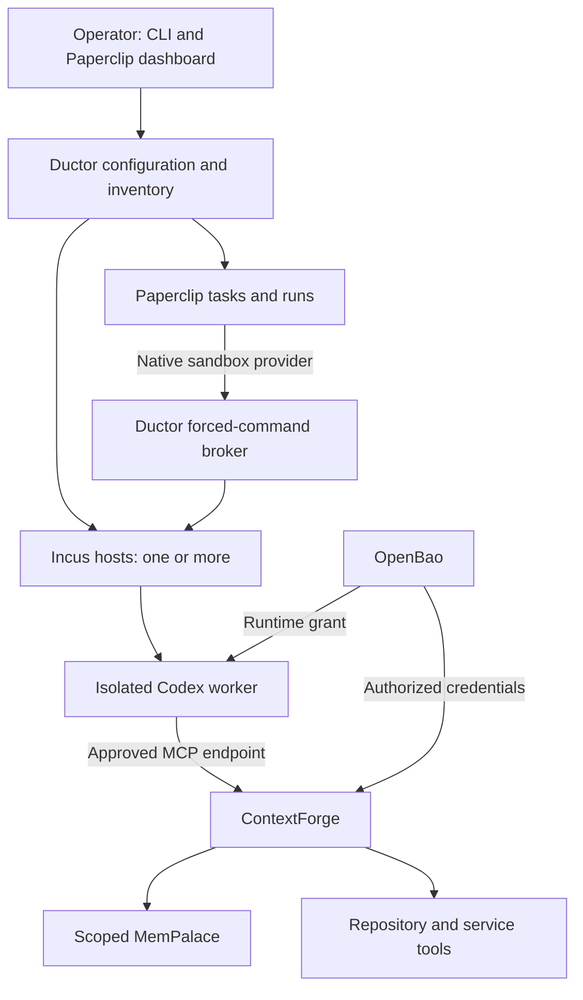

# Architecture and enforcement boundaries

Ductor is the integration and installation layer for an agent office. Paperclip
provides durable work coordination. The other selected services retain their
own responsibilities. The one-file distribution contains the Bash CLI and its
configuration templates, plus the JavaScript adapter generated for the native
Paperclip plugin SDK. Generated configuration and upstream service data live
outside the executable. No second Ductor package is downloaded at runtime.

The controller can run directly on a Linux host or inside the versioned Ductor
image. The container packages the same executable and its administration tools;
shared services run as sibling containers on the host Docker engine, and agent
VMs remain on Incus. The controller uses a persistent identity-mounted state
directory, host networking, and the host Docker socket. It runs its own SSH broker
and lease reaper without systemd. Do not run a host controller and container
controller concurrently against the same state. See [container operations](container.md).

## Ownership

| State or decision | Authority |
| --- | --- |
| Project, task, assignment, approval, run status | Paperclip |
| Accepted knowledge, decisions, and retrieval evidence | Scoped MemPalace instance |
| Tool catalog and permission to call a tool | ContextForge plus the upstream service's own permissions |
| External service credential policy | OpenBao and trusted integrations |
| Permitted ChatGPT/Codex account session | Native Paperclip AI Connection and its authorized human |
| Approved agent identity, profile, parent and account bindings | Private Ductor controller registry |
| VM ownership, placement request, controller identity | Ductor inventory |
| Enforced VM resources and isolation | Incus project, profile, and host policy |
| Source code, commit, PR, repository instructions | Git and the repository host |

Mirrored status is for convenience. Memory recall must never override a current
task assignment, revoked grant, or authoritative repository revision. Timestamped
decisions should carry the project, task, actor, and relevant commit references.
The script does not turn MemPalace into a second task scheduler.

## Service topology

The diagram describes the integration contract. A live deployment must verify
each connection, including authenticated provider transport from Paperclip's own
container and service access from a worker VM. Running the four service containers is not sufficient evidence
that an agent can execute with the required bindings.

The initial deployment is one service bundle plus any number of standalone Incus
execution hosts. All components can share a physical host, or the service bundle
and execution capacity can be separated. The role selector does not impose a
fixed server count. Splitting each control service across different hosts,
multi-controller failover, and high availability require additional deployment
work and are not supplied by the first version.

## Transport

- Use the existing Incus client and authenticated remotes for lifecycle actions.
  Use a restricted project credential wherever the required inspection APIs are
  available; a fleet controller is a trusted administrative component.
- The native Paperclip plugin reaches a dedicated controller SSH account with
  verified host keys. Its key is restricted to a forced command accepting bounded
  JSON requests. Commands supplied in requests execute only inside the owned VM
  as its nonroot UID and primary group, never in a controller shell.
- Paperclip's separate native SSH environment path remains available for manually
  prepared workers, with verified host keys and an explicit service identity.
- Use authenticated HTTPS through the trusted gateway for worker memory and tool
  requests across hosts. Each published service address and port is configurable;
  default loopback bindings support local proxies and SSH tunnels. External
  domains and certificates belong to the operator's reverse proxy by default.
- Use existing Unix sockets only for local services. No custom socket transport
  or message broker is required for the initial integration.

Network policy belongs to the Incus platform and the deployment network. Ductor
must not widen an existing profile's egress policy silently. If a worker cannot
reach its approved gateway, the integration is blocked until the route and policy
are deliberately configured.

## Bindings and credentials

A binding associates a concrete agent execution environment with its memory
scope, approved ContextForge endpoint, credential access policy, and Incus VM.
Manual registration and controlled SSH task submission refuse missing or
unverified bindings. Native profile registration precedes VM creation; acquisition
returns a lease only after bindings are installed and checked inside the guest. The runtime wrapper applies the approved configuration at
execution time; agent instructions alone are not access control.

The generated Codex administrator policy allows the intended MCP identity and
disables the separate native memory feature. The wrapper obtains a current
gateway grant, validates the catalog against the binding, and performs initial
recall before starting Codex. Model input receives bounded recall with an
explicit distinction between retrieved evidence and instructions. These runtime
checks preserve Paperclip's native authentication home and session state. Native
profiles also pin the model in the root-installed binding; conflicting model or
provider CLI overrides are refused. These controls govern the managed launch
path. VM privilege and egress policy remain the boundary for arbitrary commands
run by an agent.

OpenBao manages external-service secrets. Trusted integrations obtain only the
credentials authorized for their function. An ordinary worker should receive a
scoped gateway credential, not the OpenBao root token or an unrestricted backend
service token. Repository and email permissions must also be enforced by the
provider credentials or domain-specific tool adapter: allowing an MCP tool by
name does not itself constrain its repository or recipient arguments.

Native OpenAI subscription sessions remain in the supported Paperclip/Codex
account flow. Ductor does not convert consumer sign-ins into a general API key
pool. Account ownership, responsible user, and grants remain explicit. Paperclip
also keeps its authentication/database keys. Requiring every bootstrap secret to
come from an uninitialized OpenBao would create a circular dependency.

Bootstrap service secrets are generated privately and retained. OpenBao starts
sealed. Its initialization response is saved to an exclusive private file, and
unseal shares are read from the terminal without echo. Service health and the
ability to release credentials are reported separately.

The optional native OpenBao Agent supplies a transport SSH identity to a dedicated
volume mounted read-only by Paperclip. Its AppRole identity remains in the
sidecar. This avoids storing the transport private key in a Paperclip environment
record. It still requires verified host keys and a successful SSH test from the
Paperclip service. A previously rendered static SSH private key remains usable
until its authorization is removed or the key is rotated; sealing OpenBao does
not revoke it at the broker or a manual SSH worker.

## Memory isolation

MemPalace's HTTP token authenticates access to a palace. Wing names, agent names,
and caller-provided metadata do not establish read/write authorization.

Ductor therefore provides dedicated palace instances for separate trust
boundaries. Each scope receives a separate process, volume, and backend bearer
token. The trusted gateway holds access to those backends; a worker receives only
the approved gateway endpoint and grant. Supervisors can be authorized for
multiple scopes without giving every worker global knowledge access.

One process must own a particular palace's data. Do not run two replicas against
the same palace volume. Local embeddings reduce remote embedding costs; retrieved
evidence still consumes model context when it is supplied to Codex. Retrieval
budgets, provenance, freshness, and source revisions remain part of the task
design.

## VM admission and recovery

An inventory entry records a stable Incus server identity, selected project,
profile, pool, role, and declared allocation. Admission verifies live project
quotas and physical capacity, then accounts for existing VMs and pending Ductor
placements. Unknown resource configurations, unreachable nodes, changed server
identity, and insufficient capacity make a node ineligible.

The controller reserves a placement before creating a VM. If creation times out,
the reservation remains. Retrying the same name and resource request targets the
same host and checks ownership before reusing an existing instance. It never
automatically deletes a VM to recover from an ambiguous timeout.

All managed VMs retain CPU, memory, disk, and slot reservations while stopped.
This deliberately prevents implicit oversubscription, but it also means stopping
a VM does not free admission capacity. Automatic reservation reconciliation,
deletion and elastic scale-down are not implemented. Native Paperclip provider
acquisition composes these same inventory functions, so it cannot bypass their
reservations or live capacity checks.

Draining a host blocks new starts and allocations while preserving existing
instances. Ownership and server identity are checked before stopping a VM.
Project/profile drift must not prevent an operator from stopping an owned VM.
The controller uses a local kernel lock for mutations; it does not coordinate
concurrent independent controllers.

## Native provider lifecycle

Operator-approved profiles pin a repository, role, model, subscription grant,
image, resources, runtime account and workspace, memory/tool scope, and delegation
limits. Names are immutable policy versions. A private controller registry pins each
agent's identity and approved policy independently of its editable Paperclip
metadata. Lease acquisition, task admission and delegation verify the live record
against those pins; changing metadata does not grant a different policy.
Creation intents are private controller records too. An unconfirmed creation
response requires operator reconciliation; matching live metadata cannot be
adopted as proof that Ductor created an agent. A retried spawn can resume only
from the returned agent ID already recorded in its original intent, after
checking the live configuration against that request.
Native agent records use the Codex adapter and the Ductor runtime wrapper, with
a sandbox environment belonging to that profile. Arbitrary native agent creation
remains disabled.

The provider uses the pinned Paperclip SDK for validation, probe, acquisition,
resume, workspace realization, execution, stop/release and destruction hooks.
Paperclip retains its managed Codex authentication home, run context and native
sandbox API bridge. The plugin supplies an Incus backend to those native contracts.
It does not implement a competing task scheduler or raw host filesystem mount.

The pinned native bridge replaces the controller's Paperclip API credential with
a bridge token before guest execution. Its route allowlist excludes agent
configuration changes, including switching the execution adapter or environment;
Ductor does not widen that allowlist. The bridge permits the task APIs needed for
work. This protects the managed API path, while the VM's own privilege and network
policies still govern shell commands and direct network access.

Acquisition checks the current account grant, model and live agent/environment
configuration, then reserves a VM. Its lease is bound to company, environment and
agent; another concurrent run cannot acquire the same live allocation. Repeated
acquisition by the same run is idempotent. Resume verifies the stored ownership.
The trusted broker verifies preinstalled Codex or installs the optional approved
official release archive after SHA-256 and archive checks. It then installs the
complete Ductor executable and required bindings,
then verifies memory, tools and credentials from the actual nonroot guest.

Mutation operations hold the controller lock. Command execution does not: native
sandbox bridge control commands must run while the agent command is still active.
Commands, argument arrays, environment and stdin travel as JSON files, avoiding
host shell interpolation and oversized single command arguments. The guest helper
captures bounded UTF-8 output; oversized or binary output fails explicitly rather
than returning a silently truncated successful transfer. The RPC limit is 64 MiB;
combined guest stdout/stderr is limited to 32 MiB. Native file transfer callers
must encode binary content and respect these transport limits.

Each acquisition records its deadline before VM startup. A root-owned guest timer
and independent controller reaper enforce it; execute requests are bounded by the
remaining lease lifetime. Partial startup failure attempts to force-stop the same
owned VM. Cancellation emits a termination receipt only after Incus confirms the
VM is stopped. Destruction currently has the same conservative stop-and-retain
behavior: it does not delete disks or release inventory reservations.

A manager can request a child using the strict `/ductor spawn` issue-comment
syntax. The plugin checks the trusted event and fetches the full persisted comment
to verify author and scope. The broker checks that identity again against the task,
then checks approved child types, parent ownership and limits. Child totals count
nonterminated direct reports; concurrent limits count active child leases; depth
limits apply independently at every ancestor. A comment cannot supply its own
authenticated parent or increase the permitted policy.

Paperclip's in-process comment event delivery is not a durable queue. A missed
notification after downtime must be reconciled from task and agent records before
retrying. Persistent webhooks, durable event replay, and all external office
connectors still need deployment-specific integration and qualification.

## Work flow and human decisions

The intended workflow is an assigned task, bounded implementation, evidence,
independent review against the exact revision, correction, and completion.
Paperclip owns the task transitions and audit trail. Persistent logical agent
identity is separate from whether a VM is currently powered on.

Native Telegram, assistant MCP, routines, and other Paperclip connectors should
be reused where suitable. Ductor's initial release does not automatically wire
all external events. GitHub/Gitea PR comments and email events need an integration
that verifies their sender, deduplicates delivery, and associates feedback with
the existing task. Text received through a comment is not permission to grant
new credentials.

An approval should identify exactly what is being requested and record the
authorized actor and time. The approved task/grant is authoritative; a scoped
memory entry can preserve its explanation. A notification sent to Telegram is
not itself proof that an approval was received or applied. These complete
round-trips need live qualification before unattended operation.

## Validation boundary

Offline fixtures exercise installation and update failure recovery, admission,
ownership checks, runtime bindings, delegation policies, native provider transport,
lease cancellation and supported API shapes. Compose validation verifies syntax;
it does not verify application startup, authorization, or cross-host execution.

Before enabling unattended work, prove a small complete task cycle with a
secretary, worker, and reviewer. Verify denied access as well as successful access,
unseal/restart recovery, missing or revoked grants, unreachable workers, review
corrections, and cancellation. Measure accepted work and defects as well as token
usage. The first release makes no claim of high availability or a validated
production autonomous team.

## Upstream contracts

The implementation follows these upstream interfaces rather than defining a new
agent protocol:

- [Paperclip plugin protocol, v2026.1012.0](https://github.com/paperclipai/paperclip/blob/v2026.1012.0/packages/plugins/sdk/src/protocol.ts): native sandbox-provider lifecycle, execution, workspace, and lease contracts.
- [Paperclip sandbox requirements](https://github.com/paperclipai/paperclip/blob/v2026.1012.0/packages/plugins/sandbox-providers/SANDBOX-REQUIREMENTS.md): authority boundaries, file synchronization, and independent control commands.
- [Paperclip Codex execution adapter, v2026.1012.0](https://github.com/paperclipai/paperclip/blob/v2026.1012.0/packages/adapters/codex-local/src/server/execute.ts): managed Codex authentication home, remote execution, prompt delivery, and session handling.
- [Paperclip native bridge routes, v2026.1012.0](https://github.com/paperclipai/paperclip/blob/v2026.1012.0/packages/adapter-utils/src/sandbox-callback-bridge.ts) and [execution target](https://github.com/paperclipai/paperclip/blob/v2026.1012.0/packages/adapter-utils/src/execution-target.ts): permitted guest API operations and substitution of bridge credentials for the controller token.
- [ContextForge token routes, v1.0.11](https://github.com/IBM/mcp-context-forge/blob/v1.0.11/mcpgateway/routers/tokens.py): delegated service-user token creation, team scope, server scope, and permissions.
- [MemPalace MCP schemas, v3.11.0](https://github.com/MemPalace/mempalace/blob/v3.11.0/mempalace/mcp_server/schemas.py): memory search, drawer retrieval, and optional write/checkpoint tools.
- [Codex configuration reference](https://developers.openai.com/codex/config-reference/): administrator MCP identity allowlisting, feature requirements, mandatory MCP startup, and native memory configuration.
- [OpenBao](https://github.com/openbao/openbao): KV v2, AppRole, policies, and native Agent template rendering.

Pinning service images stabilizes server contracts. The guest Codex executable
must also support the documented configuration fields; qualify its selected
version with the installed policy before enabling real work.
